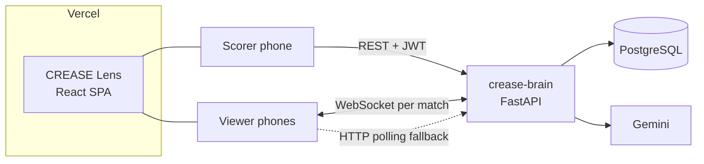

# CREASE Lens

**Frontend for CREASE, a live cricket scoring app for local matches.** A mobile-first web app where a scorer records each ball and everyone watching sees the scorecard update instantly.

**Live app:** [crease-lens.vercel.app](https://crease-lens.vercel.app) · **Backend:** [crease-brain](https://github.com/GokulAjithV/crease-brain)


<!-- Add 3 phone screenshots side by side here: home, live scoring, live scorecard -->

## What it does

- **Match setup in four screens.** Pick both teams, set the format and overs, run the toss, then choose each side's playing XI.
- **Ball-by-ball scoring.** One tap for runs, extras and wickets, with undo of the last ball.
- **Live scorecard for viewers.** Updates arrive over a WebSocket. If the connection drops, the page switches to polling and shows whether it is *Live* or *Polling*.
- **Share a live match.** Uses the phone's native share sheet, and copies the link where that isn't available.
- **Teams and players.** Create teams, invite players with a join link, add players by phone number, from the phone's contacts, or as guests.
- **Rankings and profiles.** Leaderboards by period and category, player profiles with career stats, and profile photo upload.
- **AI features.** A scouting chat for captains before a match, and an AI-written summary after it. Both are answered by the backend using match data.

## How it fits together



**One ball, from tap to every screen:**

1. The scorer taps a run on `/match/:id/scoring`.
2. The app sends it to the backend with the scorer's JWT.
3. The backend saves the ball, rebuilds the scorecard, and pushes it to every viewer's WebSocket.
4. Each viewer's `/match/:id/scorecard` page replaces its scorecard with the new one.

## Design decisions

| Decision | Why |
|---|---|
| **Mobile-first layout with bottom navigation** | Scorers stand at the boundary with one phone in one hand. Every main action is reachable with a thumb. |
| **WebSocket first, polling as a fallback** | Grounds often have weak mobile data. When the socket closes, the page polls every 5 seconds, so viewers still see the score, and the badge tells them which mode they are in. |
| **The server sends the whole scorecard** | The page replaces its state with each message. A viewer who reconnects is correct straight away, with nothing to replay. |
| **Check photos in the browser, trust only the server** | Type and 5 MB size are checked before upload for instant feedback. The backend checks again, because browser checks can be bypassed. |
| **Invite links survive the login step** | If someone opens a join link while logged out, the token is kept until they log in, and then they join the team automatically. |
| **Device features are optional** | The contact picker and share sheet are only used when the phone supports them. Every flow still works without them. |
| **The browser never calls Gemini** | All AI requests go through the backend, so no AI key is shipped to users' browsers. |
| **SPA routing on Vercel** | `vercel.json` sends every path to `index.html`, so links like `/match/123/scorecard` open directly. |

## Tech stack

| Area | Tools |
|---|---|
| UI | React 19, TypeScript |
| Build | Vite |
| Styling | Tailwind CSS 4, lucide-react icons |
| Routing | React Router 7 |
| Real time | Browser WebSocket API, HTTP polling fallback |
| Hosting | Vercel |

## Screens

| Area | Routes |
|---|---|
| **Auth** | `/login`, `/register` |
| **Home** | `/home`, `/rankings`, `/matches` |
| **Match setup** | `/match/new`, `/match/select-team`, `/match/:id/toss`, `/match/:id/playing-xi/:teamId` |
| **Live** | `/match/:id/scoring` (scorer), `/match/:id/scorecard` (viewers), `/match/:id/summary` |
| **Teams** | `/teams`, `/team/add`, `/team/:id/edit`, `/team/:id/players` (+ `/phone`, `/contacts`, `/guest`), `/join/:token` |
| **Players and AI** | `/player/:id`, `/scouting` |

## Project structure

```
src/
  App.tsx            All routes
  pages/             One file per screen
  components/layout/ Page header and bottom navigation
  lib/api.ts         API base URL and photo upload helper
  lib/utils.ts       Shared helpers
design-context.md    Screen-by-screen product design notes
feature-context.md   Feature map
vercel.json          SPA rewrite for Vercel
```

## Run locally

Requires Node.js 18+ and the [crease-brain](https://github.com/GokulAjithV/crease-brain) backend running.

```bash
git clone https://github.com/GokulAjithV/crease-lens.git
cd crease-lens
npm install
```

Create `.env.local`:

```env
VITE_API_URL=http://localhost:8000
```

Start the dev server:

```bash
npm run dev
```

Open `http://localhost:3000`. Other scripts: `npm run build`, `npm run preview`, and `npm run lint` (TypeScript type check).

## Trade-offs and what is next

- **The login token is kept in `localStorage`.** Simple, and it works across tabs, but any injected script could read it. An httpOnly cookie set by the backend would be safer.
- **API calls are written inside each page.** Moving them into one typed client in `src/lib/api.ts` would remove repeated code and give one place for auth headers and error handling.
- **After a socket drops, the page keeps polling.** The next step is to retry the WebSocket with backoff and stop polling once it reconnects.
- **No automated tests yet.** The scoring screen is the first target.

## Related

- **[crease-brain](https://github.com/GokulAjithV/crease-brain)**: the FastAPI backend (scoring APIs, WebSocket rooms, S3 photos, Gemini).
- **[Sentri](https://github.com/GokulAjithV/sentri)**: log triage platform that receives CREASE's backend logs over Kafka.

## Author

**Gokul Ajith V** · [LinkedIn](https://linkedin.com/in/gokulajithv) · [GitHub](https://github.com/GokulAjithV)